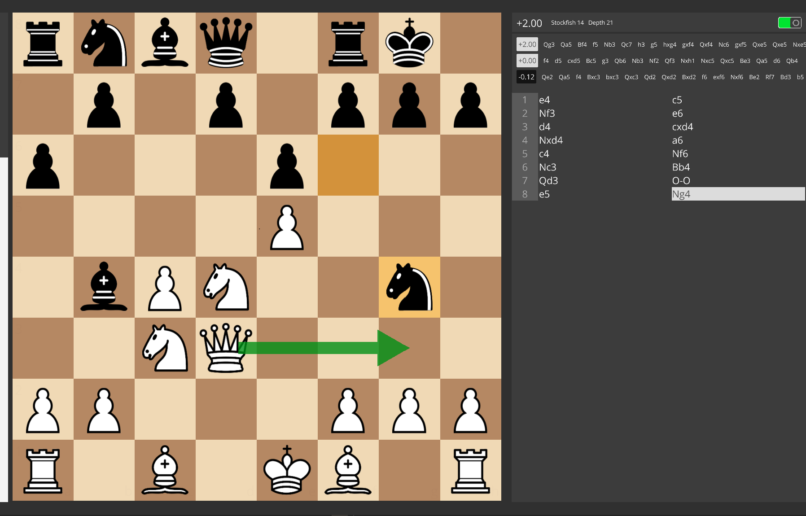
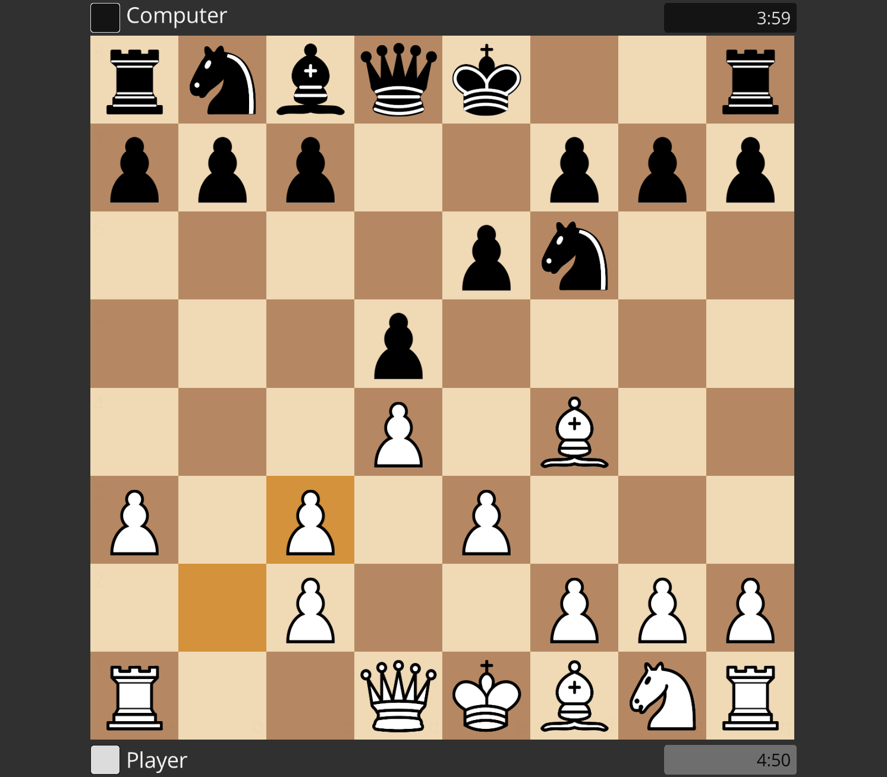
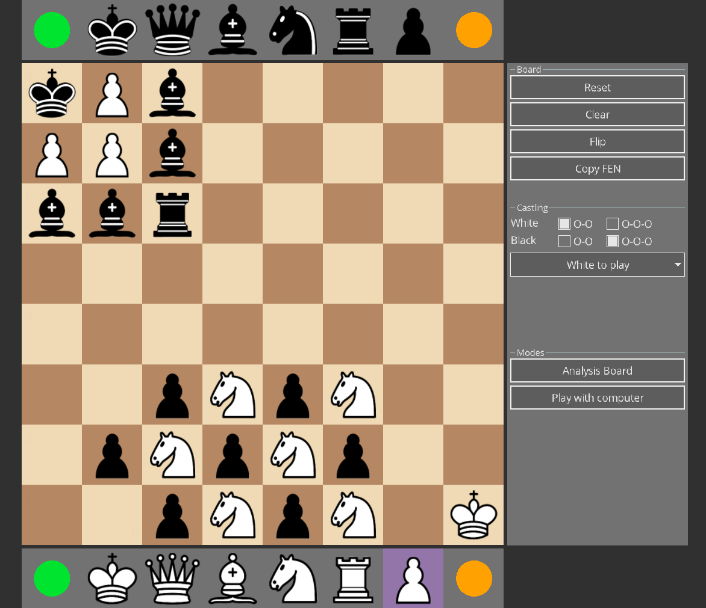

# ChessBurger

A modern, hardware-accelerated Chess GUI and Analysis tool written in C++ and Raylib. Features deep Stockfish integration for move evaluation, a custom board editor for starting games from any position, and a focus on minimalist, high-performance UI design.

# Screenshots

Analysis Board:

Game Board:

Setup Board:
